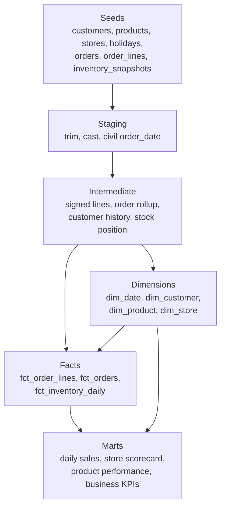
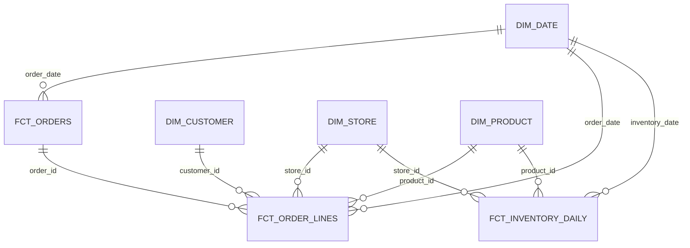

# Mercado Alba marts

Reference dbt project for **Mercado Alba**, a fictitious Mexican omnichannel retailer. Seeds land synthetic customers, products, stores, orders, order lines, and daily inventory. Models publish:

`dim_customer`, `dim_product`, `dim_store`, `dim_date`, `fct_order_lines`, `fct_orders`, `fct_inventory_daily`, `mart_daily_sales`, `mart_store_scorecard`, `mart_product_performance`, `mart_business_kpis`.

This repository is a reference implementation built with synthetic data. It demonstrates the modeling split Edgar Flores uses: staging, intermediate, and marts, with tests on grain and on the metric definitions.

Mercado Alba is not a real company. Every customer, product, store, order, and inventory row is generated. The figures below are this seeded DuckDB run.

The same fictitious retailer is used in the [Airflow ELT reference project](https://github.com/Eflores1122/airflow-bigquery-retail-elt). The two repositories do not share files. That project lands parquet. This one starts from CSV seeds and keeps order headers, a daily inventory snapshot, and the store and product marts.

## What runs locally

No warehouse account and no credentials are required.

| Piece | Local / CI | Production-shaped target |
| --- | --- | --- |
| Project | dbt Core and dbt-duckdb | The same models |
| Warehouse | DuckDB file `target/mercadoalba.duckdb` | BigQuery, optional extra |
| Schemas | `raw`, `staging`, `intermediate`, `marts` | The same dataset names |
| Fact layout | Indexes on the date, and on `store_id` plus `product_id` | `PARTITION BY` the date and `CLUSTER BY store_id, product_id` |

`macros/generate_schema_name.sql` writes the custom schema name as-is. It does not prefix `main_`. The DuckDB profile sets `threads: 1` because the file has a single writer.

Staging SQL, intermediate logic, and mart SQL are shared. The fact config is where the engines diverge. On DuckDB the facts get secondary indexes. On BigQuery they get `partition_by` and `cluster_by`. Those indexes are an access-path stand-in, not the same storage layout as BigQuery clustering. CI never selects the BigQuery target.

## Architecture





Business dates are America/Mexico_City civil dates. `ordered_at` in the order seed is a naive UTC timestamp. Staging subtracts six hours. Mexico has observed UTC−6 without daylight saving for this calendar range. The generator places local hours from 10:00 through 20:59, then stores UTC.

## Metric definitions

Amounts in the facts are integer centavos. MXN columns divide centavos by 100 and keep two decimal places.

| Metric | Definition |
| --- | --- |
| GMV | Sum of `line_amount_centavos` on completed lines with `line_type = 'sale'`. Returns are not subtracted. Cancelled lines stay in the fact and are excluded here. |
| Net sales | Sum of `line_amount_centavos` on completed lines. Return lines are negative, so they reduce net sales. |
| Gross margin | Sum of `margin_centavos` on completed lines. Margin is signed quantity times unit price minus unit cost. |
| Completed sale order | A completed order whose gross sale amount is positive. |
| AOV | GMV in MXN divided by completed sale orders. |
| Return rate | Absolute completed return amount divided by GMV. |
| Cancel rate | Cancelled orders divided by all orders. |
| Online share of GMV | Completed sale amount where `channel = 'online'`, divided by GMV. |
| Online share of orders | Orders whose channel is online, divided by all orders. |
| In-stock rate | Positions on the latest inventory date with available units above zero, divided by all positions that day. Available units are on-hand minus reserved. |
| Active customer | A customer with at least one completed sale line. |
| Customer segment | Completed orders in the window. `none` is 0, `one_time` is 1, `returning` is 2 to 4, `frequent` is 5 or more. Cancelled orders do not count. |
| Price band | `value` under 50.00 MXN, `mid` from 50.00 through 150.00 MXN, `premium` above 150.00 MXN. |

Channel is a property of the selling store. An order does not carry its own channel. Mercado Alba Digital is the only online store, so online GMV equals that store's GMV.

There is no discount in this extract. The line unit price equals the catalog unit price, and the line unit cost equals the catalog unit cost.

## Seeded run

Measured with Python 3.12.3, dbt Core 1.12.6, dbt-duckdb 1.11.1, and DuckDB 2.0.0. `dbt build` on these seeds completed 7 seeds, 22 models, and 493 data tests.

The window is 2026-01-01 through 2026-03-31. Every civil date in the window has at least one order. `mart_business_kpis` is one row for that window. `scripts/check_readme.py` fails if this section drifts from that row.

| Metric | Value |
| --- | --- |
| GMV | 1,244,657.00 MXN |
| Net sales | 1,188,405.00 MXN |
| Gross margin | 333,469.17 MXN |
| Gross margin / GMV | 26.79% |
| Orders | 1,415 |
| Completed orders | 1,356 |
| Completed sale orders | 1,333 |
| Cancelled orders | 59 |
| AOV | 933.73 MXN |
| Units sold | 6,469 |
| Order lines | 3,494 |
| Return rate | 4.52% |
| Cancel rate | 4.17% |
| Online share of GMV | 27.66% |
| Online share of orders | 28.27% |
| In-stock rate | 91.93% |
| Active customers | 329 |

Return amount is 5,625,200 / 124,465,700 centavos. Cancelled volume is 59 / 1,415 orders. Online sale amount is 34,421,500 / 124,465,700 centavos. In-stock positions on 2026-03-31 are 353 / 384. Active shoppers are 329 of 400.

Segments on completed orders: 71 with no completed order, 18 one-time, 186 returning, and 125 frequent.

GMV by store, highest first. The store mart reconciles to the same GMV, net sales, and order count.

| Store | Channel | Region | Orders | GMV (MXN) |
| --- | --- | --- | --- | ---: |
| Mercado Alba Digital | online | centro | 400 | 344,215.00 |
| Tienda Sintetica Monterrey | physical | norte | 164 | 149,794.00 |
| Tienda Sintetica Guadalajara | physical | occidente | 167 | 149,639.00 |
| Tienda Sintetica Merida | physical | sureste | 147 | 134,982.00 |
| Tienda Sintetica Tijuana | physical | norte | 152 | 131,178.00 |
| Tienda Sintetica Puebla | physical | centro | 136 | 115,762.00 |
| Tienda Sintetica Queretaro | physical | bajio | 126 | 111,429.00 |
| Tienda Sintetica Leon | physical | bajio | 123 | 107,658.00 |

## Synthetic feed

`scripts/generate_seeds.py` writes the CSV files from `random.Random(42)`. The stream is consumed in this order: customers, orders, inventory. Catalog prices are a function of `product_id` and do not draw from that stream. `make generate` rewrites the files. `make check-seeds` exits non-zero if a committed file differs. CI runs the check. It does not rewrite the files.

| Seed | Rows |
| --- | ---: |
| customers | 400 |
| products | 48 |
| stores | 8 |
| mx_holidays | 3 |
| orders | 1,415 |
| order_lines | 3,494 |
| inventory_snapshots | 34,560 |

| Entity | Grain | Notes |
| --- | --- | --- |
| customers | one shopper | Family name `Sintetico####`. Email `cliente.sintetico.####@sintetico.invalid`. Registered from 2024-03-01 through 2025-12-20, before the sales window. |
| products | one SKU | `MA-#####`. The name contains `sintetico`. Eight categories, six products each. |
| stores | one location | `Mercado Alba Digital` plus `Tienda Sintetica` in Guadalajara, Monterrey, Puebla, Merida, Tijuana, Leon, and Queretaro. |
| orders | one order | `completed` or `cancelled`. About 4% are cancelled. |
| order_lines | one product on an order | `sale` or `return`. Quantity in the seed is a positive magnitude. About 6% of lines on completed orders are returns. A cancelled order has sale lines only. |
| inventory_snapshots | store, product, and date | Full cross product for every civil date. On-hand and reserved units. Not derived from orders. |
| mx_holidays | one rest day | 1 January, the first Monday of February, and the third Monday of March. |

Customer ids 341 through 400 are never selected on an order. Other shoppers can still land in segment `none` when every order they have is cancelled. Weekday volume is higher than Saturday, Sunday, or a seeded rest day. One-off civic dates are omitted. Names, products, and stores are generated. None of them are real shoppers or shops.

## Layout

```text
models/staging/        cast, trim, civil order_date
models/intermediate/   signed lines, order rollup, customer history, stock position
models/marts/          dimensions, facts, scorecards, one-row KPI mart
seeds/                 committed CSV extract
tests/                 singular SQL tests
macros/                schema name, centavos, ISO weekday
scripts/generate_seeds.py
scripts/print_kpis.py
scripts/check_readme.py
```

`target/`, `dbt_packages/`, `logs/`, and the DuckDB file are gitignored.

## Run it

Python 3.12.

```bash
python3 -m venv .venv
source .venv/bin/activate
python -m pip install -r requirements-dev.txt
make test
```

`make test` checks the seeds against the generator, runs `dbt deps`, runs `dbt build` (seed, run, and test), then checks that this README quotes the KPI mart.

The Makefile exports `DBT_PROFILES_DIR` to the repository root and uses `.venv/bin/dbt` when that file exists. The committed `profiles.yml` contains the DuckDB output only.

| Target | What it runs |
| --- | --- |
| `make install` | Create `.venv` and install `requirements-dev.txt` |
| `make seed` | `dbt seed --full-refresh` |
| `make run` | `dbt run` |
| `make docs` | `dbt docs generate` |
| `make kpis` | Print `mart_business_kpis` |
| `make lint` | Ruff check and format check on `scripts/` |
| `make generate` | Rewrite the CSV seeds |
| `make clean` | `dbt clean` and remove `target/` and `logs/` |

GitHub Actions (`.github/workflows/ci.yml`) runs on push to `main` and on pull request. The job has `contents: read`, uses Python 3.12, installs `requirements-dev.txt`, runs Ruff, and runs `make test`. It uses no secrets.

## Tests

Singular tests reconcile line amount to quantity times price, order totals to lines, GMV to completed sales, store and product marts to the KPI row, daily sales to the fact, inventory available units to on-hand minus reserved, catalog price to the line, holiday flags to `mx_holidays`, and customer segment to the completed-order count.

Schema tests cover unique keys, not-null columns, accepted values, foreign keys, ranges, and `dbt_utils` expressions. `dbt build` on this extract is the run quoted above: 7 seeds, 22 models, and 493 data tests.

## Optional BigQuery

CI does not install `dbt-bigquery` and does not read this profile.

```bash
pip install "dbt-bigquery>=1.11,<2"
cp profiles.bigquery.yml.example profiles.yml
export MERCADOALBA_BQ_PROJECT=your-project
export MERCADOALBA_BQ_DATASET=mercadoalba
export MERCADOALBA_BQ_LOCATION=US
export DBT_PROFILES_DIR=.
dbt build --target bigquery
```

The profile dataset is the fallback schema. The schema macro still creates `raw`, `staging`, `intermediate`, and `marts` as datasets. The project that runs this needs permission to create them. Fact models set a date partition and cluster by store and product only when `target.type` is `bigquery`.

## Limitations

- Catalog price and cost do not change across the window, and the extract has no discounts.
- A return line is not tied to an original sale line. Returns are negative lines on their own order.
- Cancelled orders contain sale lines only.
- Inventory is a synthetic snapshot for every store, product, and date. It is not a ledger rebuilt from orders, and reserved units are not allocated to an order.
- Dimensions are SCD Type 1. Attributes in this generator are stable.
- The civil date uses a fixed six-hour offset. Daylight-saving rules are not applied.
- The holiday list is the three recurring rest days inside the window. One-off civic dates are omitted.
- The BigQuery profile is documented and is not executed in CI.

## License

MIT. See [LICENSE](LICENSE).

## Resumen en español

Mercado Alba es un minorista omnicanal ficticio. Este proyecto dbt transforma CSV sintéticos en modelos staging, intermediate y marts sobre DuckDB. La ventana va del 2026-01-01 al 2026-03-31 y las ventas brutas de esa corrida son 1,244,657.00 MXN. No hace falta una cuenta de nube. Ninguna fila es de una empresa real.
